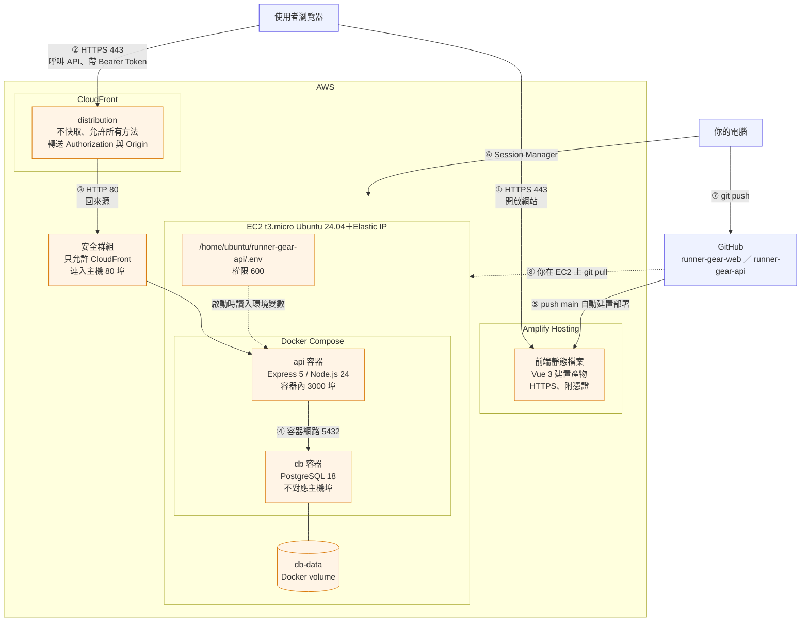
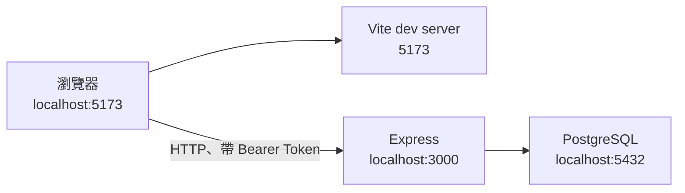

# 部署架構

對應開發計畫第 2 節。

## 總覽

## 連線一覽

| # | 從 | 到 | 協定與埠 | 說明 |
|---|---|---|---|---|
| ① | 瀏覽器 | Amplify | HTTPS 443 | 載入前端頁面。Vue Router 用 history 模式，需在 Amplify 設定 SPA rewrite，否則重新整理子頁面會 404 |
| ② | 瀏覽器 | CloudFront | HTTPS 443 | 前端以 `VITE_API_BASE_URL` 指向 CloudFront 網域。前端是 HTTPS，API 也必須是 HTTPS，否則瀏覽器會擋下混合內容 |
| ③ | CloudFront | EC2 主機 80 埠 | HTTP 80 | 來源設為 EC2 的 Public IPv4 DNS（不是 IP）。因為是 AWS 內部流量，用 HTTP 即可，不必在 EC2 上裝憑證 |
| ④ | api 容器 | db 容器 | TCP 5432 | 只走 Docker Compose 的內部網路。`db` 沒有對應到主機埠，外界無法連線 |
| ⑤ | GitHub | Amplify | — | `runner-gear-web` 的 `main` 有新的 commit 時自動建置並部署 |
| ⑥ | 你的電腦 | EC2 | Session Manager | 不開 SSH（22 埠）。從 EC2 主控台的 Connect 進入 |
| ⑦ | 你的電腦 | GitHub | HTTPS | 平常的 git 操作 |
| ⑧ | GitHub | EC2 | HTTPS | 後端不自動部署。你在 EC2 上執行 `git pull && docker compose up -d --build` |

## 各元件的部署方式

| 元件 | 部署方式 | 更新方式 |
|---|---|---|
| 前端 | Amplify Hosting 連接 `runner-gear-web` | 合併到 `main` 即自動建置部署 |
| 後端 API | EC2 上 `docker compose up -d --build`，由 `Dockerfile` 建置映像檔 | 在 EC2 執行 `git pull && docker compose up -d --build` |
| 資料庫 | 同一台 EC2 的 `db` 容器，用官方 `postgres:18-alpine` 映像檔 | 不需更新；結構變更由 migration 處理 |
| 資料表結構 | api 容器啟動時自動執行 `node src/scripts/migrate.js` | 有新的 migration 時，重新啟動容器即套用 |
| 展示資料 | `docker compose exec api npm run seed` | 同一個指令可重複執行以還原 |

兩個容器都設定 `restart: unless-stopped`，Docker 服務也設為開機啟動，所以 EC2 重開機後會自動恢復。

## 資料與機密放在哪裡

| 項目 | 位置 | 備註 |
|---|---|---|
| 資料庫檔案 | EC2 上的 Docker volume `db-data` | 重建容器不會遺失；`docker compose down -v` 會刪除，不要執行 |
| 機密值 | EC2 上的 `.env`，權限 600 | 資料庫密碼、`JWT_SECRET`、測試帳號。不進版本庫，agent 也不讀寫 |
| 前端的 API 網址 | Amplify 的環境變數 `VITE_API_BASE_URL` | 建置時寫入靜態檔案 |
| 登入狀態 | 使用者瀏覽器的 localStorage | JWT，有期限；每次請求以 `Authorization: Bearer <token>` 送出 |

## 為什麼這樣配置

- **不開 RDS**：資料庫跟 API 跑在同一台 EC2，省下整個架構最大一筆費用。代價是沒有自動備份，但本專題的資料可以用 seed 重建。
- **用 CloudFront 提供 HTTPS**：使用 CloudFront 的預設網域，不必買網域也不必管理憑證。流量極小，費用趨近於零。
- **API 走主機 80 埠**：CloudFront 以 HTTP 80 連回來源，所以 `docker-compose.yml` 把 api 容器的 3000 埠對應到主機 80。
- **安全群組只允許 CloudFront**：來源設為 AWS 提供的 prefix list `com.amazonaws.global.cloudfront.origin-facing`，不開 22 與 5432。這同時是限流能正確取得用戶端位址的前提：API 信任一層代理（`TRUST_PROXY=1`），若 80 埠對外開放，偽造的 `X-Forwarded-For` 就能繞過限流。

## 本機開發

本機沒有 CloudFront 與 Amplify：前端由 Vite 的開發伺服器提供，直接呼叫 `localhost:3000`。後端的 `CORS_ORIGINS` 要包含 `http://localhost:5173`，否則瀏覽器會擋下請求。資料庫可以直接安裝，或用 Docker 跑一個（指令見 [`../README.md`](../README.md)）。
