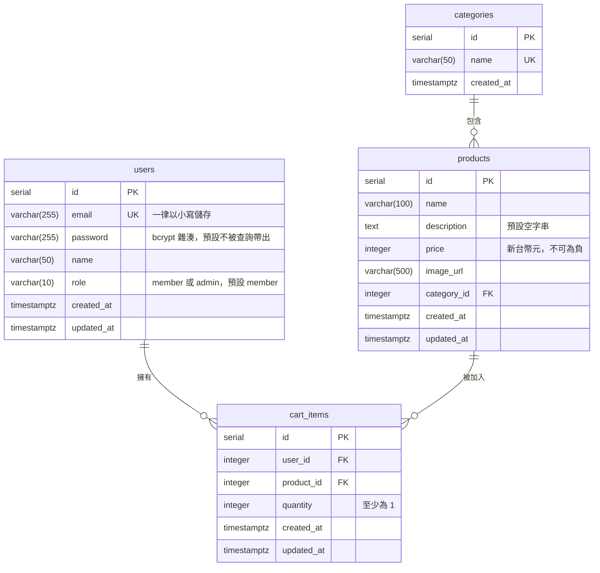

# 資料表關係圖（ERD）

對應 migration：`src/migrations/1763190000000-init-schema.js`；entity 定義在 `src/entities/`。
資料庫在整體架構中的位置見 [`architecture.md`](architecture.md)。
資料表結構有變動時，請同步更新這份文件。

## 關聯

| 關聯 | 類型 | 外鍵 | 刪除時的行為 |
|---|---|---|---|
| `categories` → `products` | 一對多 | `products.category_id` | `RESTRICT`：分類底下還有商品時不可刪除 |
| `users` → `cart_items` | 一對多 | `cart_items.user_id` | `CASCADE`：刪除會員時一併刪除其購物車項目 |
| `products` → `cart_items` | 一對多 | `cart_items.product_id` | `CASCADE`：刪除商品時一併刪除購物車中的該項目 |

`cart_items` 同時是 `users` 與 `products` 之間的多對多關聯表，並帶有數量欄位。

## 約束

所有欄位皆為 `NOT NULL`。

| 資料表 | 約束名稱 | 類型 | 內容 |
|---|---|---|---|
| `users` | `pk_users` | 主鍵 | `id` |
| `users` | `uq_users_email` | unique | `email` |
| `users` | `ck_users_role` | check | `role IN ('member', 'admin')` |
| `categories` | `pk_categories` | 主鍵 | `id` |
| `categories` | `uq_categories_name` | unique | `name` |
| `products` | `pk_products` | 主鍵 | `id` |
| `products` | `fk_products_category` | 外鍵 | `category_id` → `categories.id` |
| `products` | `ck_products_price` | check | `price >= 0` |
| `cart_items` | `pk_cart_items` | 主鍵 | `id` |
| `cart_items` | `fk_cart_items_user` | 外鍵 | `user_id` → `users.id` |
| `cart_items` | `fk_cart_items_product` | 外鍵 | `product_id` → `products.id` |
| `cart_items` | `uq_cart_items_user_product` | unique | `(user_id, product_id)`：同一會員的同一商品只有一筆 |
| `cart_items` | `ck_cart_items_quantity` | check | `quantity >= 1` |

## 索引

| 資料表 | 索引名稱 | 欄位 |
|---|---|---|
| `products` | `idx_products_category_id` | `category_id` |
| `cart_items` | `idx_cart_items_product_id` | `product_id` |

unique 約束本身也會建立索引（`email`、`categories.name`、`(user_id, product_id)`）。
